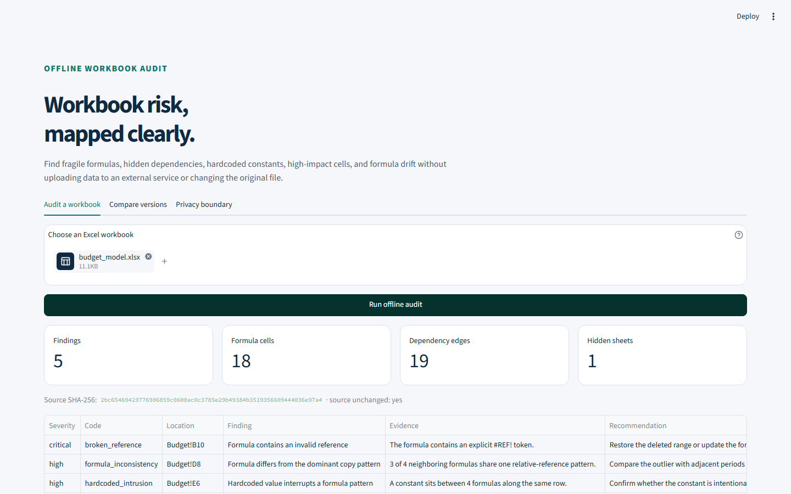

# SheetPilot Beacon

[简体中文](README.zh-CN.md)

[](https://github.com/KanadeK/sheetpilot-beacon/actions/workflows/ci.yml)
[](https://github.com/KanadeK/sheetpilot-beacon/actions/workflows/security.yml)
[](LICENSE)
[](https://github.com/KanadeK/sheetpilot-beacon/releases)

**Offline Excel formula-risk, dependency, and drift auditing.**

SheetPilot Beacon finds fragile formulas, hidden dependencies, hardcoded
constants, high-impact cells, and formula drift without uploading a workbook
or saving the original.



- **Evidence, not a score:** every finding has a code, location, evidence,
  severity, and recommendation.
- **Non-destructive by contract:** SHA-256 is checked before and after analysis;
  annotations are saved only to a new workbook.
- **Useful at the boundary:** run the same deterministic core from the CLI,
  local Streamlit UI, or Python.

```bash
python -m pip install -e ".[dev]"
sheetpilot scan examples/budget_model.xlsx --output-dir audit-output
```

Real input → real output:

```text
budget_model.xlsx: 5 findings, 18 formulas, 19 dependency edges
HTML: audit-output/budget_model.audit.html
JSON: audit-output/budget_model.audit.json
Annotated workbook: audit-output/budget_model.annotated.xlsx
```

The core makes no network requests and retains no raw constant values in its
snapshot or HTML/JSON reports. The annotated workbook is a full copy of the
source and therefore still contains the source data; keep it inside the same
trust boundary. Current contract: **v0.1.0**, Python 3.12, `.xlsx` only.

## What it detects

| Detector | What it flags |
|---|---|
| `hardcoded_intrusion` | A constant interrupting an otherwise repeated formula run |
| `broken_reference` | An explicit `#REF!` token |
| `formula_inconsistency` | A formula outside the dominant relative-reference pattern |
| `high_fanout` | A cell feeding at least the configured number of formulas |
| `hidden_dependency` | A visible calculation depending on a hidden sheet |
| `external_link` | A formula or workbook relationship pointing outside the file |
| `circular_reference` | Formula cells participating in a dependency cycle |

It also inventories formulas, named ranges, hidden and very-hidden sheets,
merged ranges, and external links; builds cell and sheet dependency graphs; and
compares two versions for formula, constant-fingerprint, and sheet drift.

## Install

### From a clone

```bash
git clone https://github.com/KanadeK/sheetpilot-beacon.git
cd sheetpilot-beacon
python -m venv .venv
python -m pip install -e ".[dev]"
```

Use the Python 3.12 interpreter from the virtual environment for every command.
The repository also carries `uv.lock`; contributors using uv can run:

```bash
uv sync --frozen --all-extras
```

### From the GitHub Release

Download the platform-independent wheel from
[v0.1.0](https://github.com/KanadeK/sheetpilot-beacon/releases/tag/v0.1.0),
verify it against `SHA256SUMS.txt`, then install it:

```bash
python -m pip install sheetpilot_beacon-0.1.0-py3-none-any.whl
```

## Quick start

Audit all three committed synthetic workbooks and build a static report index:

```bash
sheetpilot demo --samples-dir examples --output-dir demo-output
```

Open `demo-output/index.html`, or use the published
[static sample demo](https://kanadek.github.io/sheetpilot-beacon/).

Launch the local interface:

```bash
sheetpilot web --port 8501
```

The UI supports audit, version comparison, HTML/JSON downloads, and annotated
workbook downloads. Uploads stay inside the local Streamlit process.

## CLI

```text
sheetpilot scan WORKBOOK [--output-dir DIR] [--fanout-threshold N]
                          [--fail-on none|critical|high|medium|low|info]
sheetpilot diff BEFORE AFTER [--output-dir DIR]
sheetpilot demo [--samples-dir DIR] [--output-dir DIR]
sheetpilot web [--port PORT]
sheetpilot --version
```

`scan` returns `0` on a successful audit, `1` for an input/output failure, and
`3` when `--fail-on` is enabled and at least one finding meets the threshold.
The severity gate makes the command suitable for controlled CI use without
turning parser failures into empty success reports.

Compare two workbook versions:

```bash
sheetpilot diff \
  examples/budget_model.xlsx \
  revised-budget.xlsx \
  --output-dir drift-output
```

The drift model distinguishes formula added, removed, changed, replaced by a
constant, constant replaced by a formula, constant fingerprint changed, and
sheet added or removed. Constant values themselves are not written to reports.

## Python interface

There is no network API in v0.1.0. The supported programmatic boundary is the
typed service layer:

```python
from pathlib import Path

from sheetpilot_beacon.services.audit import audit_workbook
from sheetpilot_beacon.services.diff import compare_workbooks

audit = audit_workbook(Path("examples/budget_model.xlsx"))
print(audit.metrics.formula_cell_count, len(audit.issues))

drift = compare_workbooks(Path("before.xlsx"), Path("after.xlsx"))
for change in drift.changes:
    print(change.kind.value, change.sheet, change.cell)
```

Pydantic models are immutable and reject unknown fields. Time-dependent audit
code accepts an injectable clock for reproducible tests and demos.

## Sample contract

The repository includes three MIT-licensed synthetic workbooks:

| Workbook | Formulas | Expected findings | Scenario |
|---|---:|---:|---|
| `budget_model.xlsx` | 18 | 5 | Department budget and hidden assumptions |
| `sales_forecast.xlsx` | 18 | 5 | Regional forecast and legacy external rate |
| `engineering_boq.xlsx` | 18 | 5 | Bill of quantities and cost roll-up |

`examples/expected_findings.json` declares all 15 expected
`(code, sheet, cell)` tuples. Integration tests fail on a missed issue and on
an unexpected extra issue. See [sample details](examples/README.md).

## Output formats

- **HTML audit:** standalone, responsive, keyboard-readable evidence table.
- **JSON audit:** stable typed evidence for automation; no raw constant values.
- **Annotated `.xlsx`:** a new copy with a `Beacon Audit` sheet, comments,
  hyperlinks, filters, and severity coloring.
- **HTML/JSON drift:** exact workbook changes and source hashes.

Exporters HTML-escape all workbook text and prefix formula-shaped values written
to the audit sheet, preventing report markup injection and Excel formula
injection in generated audit cells.

## Architecture

```text
CLI / Streamlit / Python
            │
services: audit · diff · demo
            │
domain: immutable models · formula parser · graphs · detectors · drift
            │
adapters: openpyxl reader · HTML/JSON/XLSX exporters · sample generator
```

The domain layer has no Streamlit or network dependency. Dependency edges point
from precedent to dependent. Readers never ask Excel to calculate formulas.
See [the architecture document](docs/ARCHITECTURE.md) for invariants, module
ownership, and data flow.

## Privacy and security boundary

- The analyzer is offline and has no telemetry.
- `.xlsx` is treated as untrusted input; corrupt archives fail explicitly.
- File size defaults to 100 MiB, worksheet extent to 1,000,000 cells, and
  expanded formula ranges to 10,000 cells.
- Constant cells are represented by type-aware SHA-256 fingerprints, not raw
  values.
- Credential-shaped formula and external-link evidence is redacted.
- Macros are not executed. `.xls`, `.xlsm`, and password-protected workbooks
  are outside this release contract.
- Static analysis does not prove a workbook's calculated values are correct.
- An annotated copy retains all source workbook data. Review every generated
  artifact before sharing it.

Read [Privacy and Security](docs/PRIVACY_AND_SECURITY.md) for the threat model,
controls, residual risks, and disclosure guidance.

## Verification

The complete local gate runs lint, format verification, strict mypy, all unit,
integration, privacy, regression, and E2E tests with branch coverage, followed
by isolated wheel and sdist builds:

```bash
python scripts/verify.py
```

Equivalent focused commands:

```bash
python -m ruff check .
python -m ruff format --check .
python -m mypy src
python -m pytest -q --cov=src --cov-report=term-missing --cov-fail-under=80
python -m build
```

The v0.1.0 release gate passed **42 tests at 85.82% total coverage** on Windows
and exercised three subprocess CLI workflows plus the Streamlit application
contract. See [Benchmark](docs/BENCHMARK.md) for measured sample latency and
[Release Checklist](docs/RELEASE_CHECKLIST.md) for the publication gates.

## Reproduce the demo assets

The screenshot above is generated from a live local Streamlit process after
uploading and auditing `examples/budget_model.xlsx`.

```bash
python -m playwright install chromium
python scripts/capture_demo.py
```

The script waits on Streamlit's health endpoint, uploads the real workbook,
asserts that the audit and download controls are active, and captures the
rendered result. No production workbook is used.

## Non-goals and known limits

- Formula evaluation, financial-model certification, and business-value
  validation.
- Editing or repairing the source workbook.
- VBA, `.xls`, `.xlsb`, `.xlsm`, encrypted files, Power Query, data
  connections, and full Excel calculation-chain emulation.
- Perfect parsing of every Excel dialect extension, table structured
  reference, dynamic array, or cube formula.
- A hosted upload service. The published Pages site contains generated
  synthetic reports only.

Detector results are review leads, not proof of an error. False positives and
false negatives remain possible, especially in intentionally irregular models.

## Roadmap

Post-0.1 priorities are table-structured references, configurable policy files,
SARIF output, larger-workbook streaming, and calibrated detector profiles for
finance and engineering models. Changes to detector semantics require synthetic
fixtures and regression evidence.

## Contributing and security

Read [CONTRIBUTING.md](CONTRIBUTING.md) before changing detector behavior. Use
synthetic workbooks only. Security reports belong in GitHub private
vulnerability reporting; see [SECURITY.md](SECURITY.md).

The public-repository sample scan found no active project with both the same
name and a highly isomorphic feature set. SheetPilot Beacon differentiates on
the combined offline risk rules, formula-to-constant drift, non-destructive
exports, and executable 15-finding sample contract. This is a bounded sample,
not a claim of global uniqueness. See
[Competitor Scan](docs/COMPETITOR_SCAN.md).

## FAQ

### Does it upload my workbook?

No. The CLI, Python core, and local Streamlit process make no outbound requests.
The static demo is generated from synthetic repository samples and cannot
accept uploads.

### Does it change my workbook?

No. The source hash is checked before and after audit. If requested, a separate
annotated copy is written to a different path.

### Why are raw constant values absent from JSON and HTML?

They are not required for structural formula analysis. The model stores a
type-aware fingerprint so version diff can detect a constant change without
serializing the value.

### Is every finding a defect?

No. A finding is evidence that deserves review. The recommendation explains the
next check; intentional exceptions can remain in the workbook.

### Can I audit `.xlsm` or calculate formulas?

Not in v0.1.0. The accepted format is `.xlsx`, and the analyzer reads formula
text without running Excel, macros, or a calculation engine.

## License

[MIT](LICENSE). The three synthetic sample workbooks and generated sample
reports are covered by the same license.
